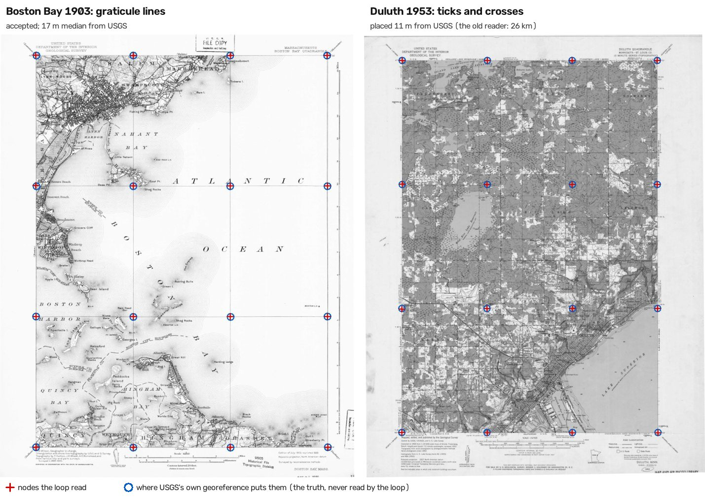

# AnyGeoreference

**Put any scanned drawing or map on the Earth, say how sure you are, and say no when you are not.**

Status: v0 design and core loop (2026-11). Kinds placed so far: scanned planning drawings (Great Britain), historical 1-inch survey sheets (South Asia), USGS historical quadrangles (public demo below) and German 1:25,000 sheets (second held-out family). A new kind is a recipe, not a rewrite; the core does not change.

## Try it: public sheets, external truth, one command

```bash
git clone https://github.com/jiaazhaoo/AnyGeoreference.git && cd AnyGeoreference
python -m venv .venv && . .venv/bin/activate && pip install -e ".[test]"
python demo/run_demo.py          # fetches 16 public-domain USGS scans (~125 MB) once; then ~25 s, CPU only
```

No model, no API key, no GPU, no private data. Each case is a USGS historical topographic sheet (1888–1953, seven
states, 1:62,500 and 1:24,000) given as two scans of the same sheet (two editions, or two printings). The record
holds only what a person reads off the sheet's corners: the neatline bounds and the graticule interval. Each scan is
placed from its pixels alone (`graticule_marks`, then a poly2 fit and the residual at the nodes). The reader finds
the neatline, the frame where the map content stops on every side. It then confirms every graticule node by a mark:
a line crossing, an interior cross, or a one-sided tick on the edge. Sheets that print the graticule as lines and
sheets that print only ticks and crosses go through the same reader. Each placement is then checked against the
other scan's, by map content. The two scans are resampled onto one lon/lat grid, the graticule is masked out (it
agrees by construction), and the coast, roads and contours must line up (`edition_agreement`). An external family
needs neither the sheet's lines nor the record. It takes the sheet's water (the blue plate) through the placement and
compares it with OpenStreetMap's water, fetched for that sheet only (`basemap_agreement`). The policy accepts when
the graticule fit has a second family that agrees: the other scan, or the water. A water disagreement sends the scan
to review, and so does a partner shown wrong by it. Only after the decision does the scorer open each GeoTIFF's own
georeference, which is the truth, and measure the distance on a 7 × 7 grid over the map. The water check needs
network access once per sheet; without it, that family says "nothing to compare".



| | scans | accepted, right | accepted, wrong | to review | abstained |
|---|---|---|---|---|---|
| sheets | 16 | 15 (worst point 12–56 m from USGS) | 0 | 1 (placed right) | 0 |
| controls | 4 | 1 (placed right; its "partner" was another sheet) | 0 | 3 (2 of them the record typo, caught) | 0 |

- **Duluth 1953** prints no graticule lines, and the Public Land Survey's one-mile sections are ruled across it. The
  first reader (`graticule_lines`) took four section lines for the graticule and placed the sheet 26 km off. The
  edition check caught it. The current reader places it 11 m from USGS. Its 1895 partner was re-surveyed and shares
  no content to compare, but its water matches OpenStreetMap within 5 m, so it is accepted.
- **Controls.** A pair of two different sheets has no overlap to compare. One of them is still accepted (right),
  because its own water matches OpenStreetMap. **The record typo, closed:** a record whose bounds are one interval
  off is read the same wrong way on both scans, and the two scans agree. Every version before the water check
  accepted both, 6.9 km off. Now one scan's water shows a 6,836 m shift against OpenStreetMap. The other scan has
  too little water to compare, but it agreed with a partner that has been shown wrong, so both go to review.

Per-scan table and overlays: `demo/out/` after a run. Method and numbers: `docs/FINDINGS.md`.

### Held-out: random quadrangles, each draw run once

The demo's sheets were chosen by hand, so its numbers are development numbers. `benchmarks/sample_usgs15.py` draws
15' quadrangles by a fixed, seeded rule that never opens an image: uniform random points over the contiguous US, the
quadrangle holding each point, and two scans of it. It excludes every quadrangle seen before. The code is frozen and
committed, the draw is committed, and each draw is run once. The results are reported as they came out. A draw
that has been looked at becomes development data, and the next change is measured on a new one.

| 200 scans per draw | reader | accepted, right | accepted, wrong | to review: placement right / wrong | abstained |
|---|---|---|---|---|---|
| v1 (seed 20261108, run at `72f30da`) | lines only | 55 | **0** | 15 / 25 | 105 |
| v2 (seed 20261109, fresh, run at `9996f0f`) | frame and marks | 129 (worst point ≤ 62 m) | **0** | 39 / 24 | 8 |
| v3 (seed 20261110, fresh, run at `f56db57`) | + ambiguity ruled out by evidence | 155 (worst point ≤ 58 m) | **0** | 25 / 16 | 4 |
| v4 (seed 20261112, fresh, run at `122a307`) | + water vs OpenStreetMap | **155** (worst point ≤ 76 m; 15 by water alone) | **0** | 21 / 17 | 7 |
| v5 (seed 20261114, fresh, run at `a9f94ff`) | + datum from the record, marks beyond chance, frame-only, water tolerance 60 m | **135** (2 by the frame alone) | **0** | 45 / 3 | 17 |

Each row is a different random draw, so the rows compare systems, not identical cases. v2 measured the frame-and-
marks reader: editions from 1945 on went from almost none placed to 69 of 108 accepted. Its cost was 17 right
placements held back by an ambiguity rule that compared total scores. v3 measured the fix: a rival frame counts as
doubt only if it would place the sheet elsewhere and the evidence does not rule it out. The deciding evidence is where
the map content stops, because marks saturate (a section grid can carry every mark). On v3 the rule holds back 3 right
placements. All 16 wrong placements were held back: 14 because the other edition's content did not correlate, 1
because the editions disagreed, and 1 because the partner was not placed. v4 measured the water family. 15 scans were
accepted on the water alone, with no usable partner edition. Its main effect is safety: the record-typo hole, which no
earlier version could see, is closed. Rows are different draws; on the same development draws the water family adds
9 accepted placements per draw and no wrong ones. Per-scan results: `benchmarks/results/`.

v5 measured the changes a second map family forced (below). The water tolerance went from 150 m to 60 m, the
editions' tolerance, because a check may not be looser than the 100 m it certifies. That costs acceptances: on the
same v4 draw, 155 became 143, all 12 right placements whose water sat 60–121 m from OpenStreetMap's.

```bash
python demo/run_demo.py --cases benchmarks/usgs15_heldout_v5.json --data benchmarks/data --out benchmarks/out/usgs15_heldout_v5   # ~1.3 GB of scans, ~25 min
```

### Held-out, a second family: German 1:25,000 sheets, 1873–1900

To test whether the method is general and not fitted to USGS sheets, the unchanged system was run once on
another family: 1:25,000 sheets (Messtischblätter and Saxon Äquidistantenkarten) from the SLUB Virtual Map Forum,
Dresden. Everything about them differs: country, survey, datum (Bessel; the record states DHDN), longitudes east of
Ferro, a 10' × 6' sheet, printer, scanner and library. `benchmarks/sample_slub.py` draws TK25 cells by a seeded rule.
Each scan's truth is the original registered to the library's own rectified GeoTIFF. The library warps with
splines, so the truth model is poly2 plus a smoothed thin-plate spline, with a held-out error p95 of 9 m median and
19 m at worst. That truth agrees with OpenStreetMap's water to 14 m (median) over 81 scans.

| 100 scans per draw | system | accepted, right | accepted, wrong | to review: right / wrong | abstained |
|---|---|---|---|---|---|
| v1 (seed 20261111, run at `ec9f660`) | as frozen for USGS, unchanged | 0 | **3** | 0 / 15 | 82 |
| v2 (seed 20261115, fresh, run at `a9f94ff`) | after the failure classes of v1 were fixed | 3 (6–11 m median) | **0** | 4 / 48 | 45 |
| v3 (seed 20261116, fresh, run at `0f76dad`) | + series field across the batch (review only) | 1 | **0** | 4 / 50 | 45 |

v1 was the first wrong acceptance on any held-out set. Its failure classes, each fixed as a capability and not for
the cases:
1. **The datum was hard-coded to NAD27,** a null shift outside North America. The placement now takes the datum the
   record states.
2. **The water tolerance (150 m) exceeded the 100 m it certifies.** Datum errors of 110–130 m passed, so it is now 60 m.
3. **Marks were counted without a null.** These sheets print no minute ticks at all. Yet 40–50 % of the expected
   "marks" were found, by ink near any point. The same tests now run at control positions off the graticule, and only
   marks beyond that chance rate count.
4. **A sheet that prints only its neatline** is now placed by the four corners, if the content clearly stops at the
   frame. It is accepted only on the external check, never on another edition, because two editions share the
   frame and the content. On v2 this rule held back 3 wrong placements that the editions agreed on.

**What v2 shows about the sheets.** The 1870s–1890s Saxon sheets print their frame 150–600 m away from the
geographic cell the record names. The offset varies smoothly with longitude: +500 m at 12.2° E, −540 m at 14.8° E,
the same on both editions. They were laid out in a Saxon coordinate system, so the record is wrong for them. Reading
the frame perfectly cannot make them right. The water check sees it on every sheet that has water. The 3 accepted
placements are sheets outside Saxony. Making Saxon sheets right needs the series' own coordinate system. That could be
learned from a few sheets against an external reference and verified on others.

**The series field (v3).** The batch learns the series' shared error from the sheets' own water shifts against
OpenStreetMap. Each sheet is left out of its own field, and the truth is never used. For a sheet whose water
disagrees, the field moves the record and the sheet is placed again. On v3, all 50 such scans moved closer: median
error 336 → 98 m, worst point 444 → 175 m, none worse. It never accepts, by design. In development, allowing it to
accept on the sheet's own water accepted 10 wrong sheets. Each was right in the middle and 100–260 m off at the edges.
On Saxon sheets, even the best affine fit to the truth itself has its worst point at 73 m (median) and 123 m (p90).
Their content is distorted inside the sheet. A frame plus a series offset cannot be certified to 100 m, and a water
shift, even per quadrant, cannot see what is left. So the field gives a reviewer a sheet about 100 m off instead of
about 340 m. Making these sheets right needs a warp fitted to their content against a modern reference, with a
third reference left to verify it.

```bash
pip install -e ".[bench]"      # truststore: the library's TLS chain verifies against the system trust store
python benchmarks/sample_slub.py --n 50 --seed 20261115 --exclude benchmarks/slub_heldout_v1.json --out /tmp/slub_v2.json   # rebuilds the scans and truth
python demo/run_demo.py --cases benchmarks/slub_heldout_v2.json --out benchmarks/out/slub_heldout_v2
```

### Coordinate-free: no corners, no graticule, no labels

Every benchmark above hands the system the sheet's corner coordinates and its graticule interval. With those, placing
a sheet is reading marks and fitting. The hard case is a map that carries none of it.
`benchmarks/coordfree.py` builds that case from scans whose georeference is already known. It cuts a window out of
the map body: 40–70 % of each side, at a random place, inside the sheet bounds shrunk by 8 %. The margin, its
coordinate labels and every edge tick are left outside. The truth is the source georeference moved by the crop, so
it comes for free. A system under test reads the window image and one hint, run three ways:

| tier | hint |
|---|---|
| none | nothing |
| region | the state, or the country (`West Virginia, United States`; `Germany`) |
| title | the place in the catalogue title, any sheet number or scale removed (`Harrisville, West Virginia, United States`; `Dillenburg, Germany`) |

Right is the same as above: the worst of 7 × 7 points over the window within 100 m. Placements that are not right are
still graded by their median distance (within 1 km, within 10 km), because finding the area is a capability of its
own.

| set | source | cases | status |
|---|---|---|---|
| `coordfree_dev_usgs` | 40 quadrangles of USGS v4 (seen) | 40 × 3 tiers | development |
| `coordfree_dev_slub` | 20 sheets of SLUB v2 (seen) | 20 × 3 tiers | development |
| `coordfree_heldout_v1` | 100 fresh USGS quadrangles (seed 20261123, every earlier draw excluded), one scan each (seed 20261124) | 100 × 3 tiers | held out, not built or run yet |

**Baseline, development sets (2026-11-09):** the existing coordinate-free recipe (`street_map`: read names, look
them up, fit roads, check places) placed **0 of 180** runs. The reader is not the problem: it read 6–40 place and
landmark names in every window (median 18 on USGS, 22.5 on German sheets). Every later step failed. The place lookup
is bound to Ordnance Survey Open Names, which covers Great Britain only and is not in this repository. The road
matchers import a module that is not public. So the public system cannot place a map without coordinates anywhere
outside Britain. That is the starting point the next capability is measured from. The held-out set is untouched.

```bash
python benchmarks/coordfree.py build benchmarks/coordfree_dev_usgs.json      # windows + truth under benchmarks/data/coordfree/
python benchmarks/run_coordfree.py benchmarks/coordfree_dev_usgs.json --kind street_map --out benchmarks/results/coordfree_dev_usgs_street_map
python benchmarks/coordfree.py score benchmarks/coordfree_dev_usgs.json my_results.json
```

## Why

Georeferencing a scanned plan is a multi-step task that needs both reading and computing: somebody has to read the
road names, house numbers and place names on the sheet, then find where on the national map those names fit, then
check the fit. Language and vision models read well and compute badly; they are not deterministic and cannot be
trusted with coordinates. Spatial tools compute exactly and read nothing. A system that lets the model read and the
tools compute, keeps every hypothesis with its score, verifies against evidence the model did not produce, and
abstains when the evidence is thin, is more defensible than either alone. That principle is stated in the literature
on language-guided spatial analysis; this repository is one end-to-end instance of it with a benchmark that has
external truth.

The name is a direction, not a claim: generality comes from the tool and knowledge interfaces, not from one model.

## Three levels

| level | question | answered by |
|---|---|---|
| L1 runtime, per sheet | where does this sheet go | the loop below |
| L2 recipe, per kind of map | how do sheets of this kind get placed at all | profile the samples, compose from a primitive library, generate the adapter, pilot with truth, freeze (`docs/RECIPE.md`) |
| L3 production, per batch | how to place thousands without an accident | a control layer: budget, caps, sentinel, rollback |

Four kinds are placed today: planning drawings, historical survey sheets, unlabelled rasters (synthetic so far) and street maps with names. A user who brings another kind goes through L2.

## The loop

| step | who | produces |
|---|---|---|
| SEE | a vision-language model | cues: text and symbols read off the sheet, with where on the sheet they are |
| RETRIEVE | gazetteers, address registers, road networks, base maps | candidate areas that could hold those cues |
| MATCH | deterministic matching (text anchors, raster-to-vector, raster-to-raster) | placement hypotheses: a transform, the site polygon in the target CRS, a score; always a set |
| VERIFY | independent checks (snap to map faces, address point inside, drawing relations vs map relations) | evidence with an independence family |
| DECIDE | a measured policy and a calibrator (from `geo-eval`) | a placement with a probability, or *abstain*; the trail; the cost |

The same tools run under two drivers: a fixed plan (the production baseline) and an LLM planner that chooses the
next tool from the registry. Both are evaluated on the same benchmark, which is the experiment this repository exists
to run: what does a model's reading add to deterministic georeferencing, and when must it abstain.

## What we measure

Per kind of input, on cases whose true location is known from an external source: placed right, placed wrong
(weighted heavier than an abstention), abstained, cost, and calibration (`ga/bench.py`, through geo-eval).

First numbers (2026-11-06, data stays out of the repository):

| kind | input | truth | result |
|---|---|---|---|
| historical map | one Survey of India quarter sheet (1943), the archive's published raster taken as pixels only | the archive's own georeference | 49 graticule nodes read in 2.7 s; our placement 33 m rms / 29 m median from the archive's; the sheet's printed coordinates themselves sit 31 m from the archive's, so the loop reproduces the printed placement and the rest is the archive's datum shift |
| unlabelled raster | a road-network render of a city district, rotated 7° and shifted, with a location hint 0.5 km off and no text | the known transform | ORB + RANSAC against reference roads: corners 5–7 m, centre 1 m, overlay agreement 0.85, in 0.5 s |
| planning drawing | ten frozen benchmark drawings; cues from Claude's reading plus cached OCR; OS Open Names, the local address register, the pipeline's learned matcher on OS tiles (GPU) | the client's graded polygon | hypotheses on 9 of 10, within 100 m on 5; the matcher's score alone would accept a 736 m miss, so acceptance needs the address point inside the footprint as a second family: 3 accepted (7, 13, 86 m), 0 wrong, the rest to review or abstained (the floor plan abstains because nothing on it places it). The production flow, with road-name checks not bound here, accepts 6 of the same 10 |
| historical map, six sheets | six sheets from two series and three decades, pixels only | the archive's georeference, 100 m at the centre | under the rule "accept only with a second evidence family": 3 accepted (2 within 65 m of the archive, 1 at 654 m where our two matchers agree with each other, not with the archive), 3 to review (two frame reads one graticule line off at 9 km, caught; one false alarm at 61 m). Without the rule: 6 accepted, 3 wrong. `docs/FINDINGS.md` |

### The main agent

Give it one to three similar sheets. It reads each (Claude), profiles the batch (what cues all sheets share, what
varies), retrieves from the knowledge base (`docs/KNOWLEDGE.md`: 75 cards, what a professional georeferencer
knows about map families, reading, reference data, geodesy, transforms, matchers, verification, truth, failure
modes, cost and the literature, with our measured findings), reads the capability catalogue (which known methods
the library implements, which are known to be buildable), and writes the plan: a recipe over the library, where
truth will come from and how far it is trusted, the evaluation, the stop rules, the missing primitives with a
method each (the builder writes them), the risks. With one sheet it says so: no batch agreement, deliveries
need an external truth. `python -m ga.cli plan --kind ... --images a b c`. Two first plans are in `docs/FINDINGS.md`.

### Blind test

Four inputs the system had never seen, no kind hint: a 1903 USGS sheet (placed to 23 m rms by a generic graticule
reader the agent asked for), an 1823 engraved town plan and an OSM-style suburb render (first abstained / held:
the library lacked a street-name matcher; with road-name fitting added, both placed and accepted, 13/25 and 17/22
labels on their roads), an oblique photograph (abstained: nothing on it places it). No confident wrong placement.
Details in `docs/FINDINGS.md`.

### Planner against the fixed plan

Ten drawings, the same tools and cache, truth from the client's grading; the planner is Claude through the
platform's own CLI, shown state summaries without coordinates. Outcomes identical on every case (one verified
placement at 7 m sent to review, nine abstentions, no discordant pair); the planner took 4–12 steps against the
fixed 11, stopped after 4 on sheets with nothing to place, and lost steps where tool contracts were too coarse.
Details in `docs/FINDINGS.md`.

## Install

```bash
git clone https://github.com/jiaazhaoo/AnyGeoreference.git && cd AnyGeoreference
python -m venv .venv && . .venv/bin/activate
pip install -e ".[test]"          # pulls geo-eval (the evaluation core) from GitHub
python -m pytest -q tests
```

## Run it

```bash
python -m ga.cli kinds                      # the three kinds, their steps, what is unavailable on this machine
python -m ga.cli primitives                 # the library: family, determinism, contract, source, implemented?
python -m ga.cli run --kind soi_1inch --image sheet.tif --record '{"sheet_code": "053BSW"}'
python -m ga.cli run --kind unlabelled_raster --image tile.png --record '{"hint_xy": [435000, 387000]}'
python -m ga.cli run --kind plans_gb --image page.jpg --record '{"address": "..."}' --meta '{"ocr_jsonl": "...", "page": "..."}' --planner
python -m pytest -q tests
```

Bound primitives need their source repositories and data (the planning pipeline with OS Open Names, AddressBase
and Zoomstack; the historical-map project with its MINIMA weights; Overpass). Everything else runs anywhere.

## Where it sits

- `geo-eval`: the policy table, calibration and the gate that every change must pass
- the production pipeline this grew out of supplies the first adapter's tool implementations

## Origin

Grown from a production system that places planning drawings on the national grid for a client
(2026-09 to 2026-11); its measured dead ends (rotation sweeps, longer search budgets, confirmation scores) are what
this design answers. Data and client names stay private.
